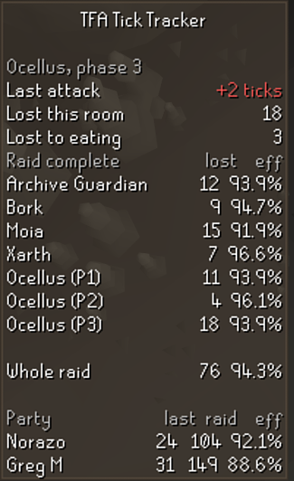

# Tfa Tick Tracker

Measures the attack ticks you lost, room by room, in The Fractured Archives.

A tick you were off cooldown, in a live fight, with something to hit, and did not attack is a tick
lost. The plugin counts those, tells you what each attack cost the moment it lands, and gives you a
per-room summary afterwards — in an overlay while you raid, and in a sidebar panel that breaks the
raid down by raider and by room.

It measures **your own** attacks only. Attack speed, weapon and attack option are not readable for
other players, so everyone else's numbers are self-reported over the RuneLite party rather than
observed. Room totals only ever leave your client, never anything per-attack.

## What it looks like

### The overlay, while you raid

The top block is the fight you are in — what your last attack cost, what the room has cost so far, and
how much of that was food. Under it, every room of the raid with its lost ticks and efficiency,
including the ones you have not reached yet, so the overlay never changes height mid-fight. The party
table at the bottom is off by default.

Only the last attack is ever coloured. Seven rooms of red and green is a wall rather than a signal, so
the standing numbers stay neutral and the one line you glance at mid-fight carries the colour.

### The panel, for afterwards

One collapsible card per raider, each listing the raid room by room, with a toggle to pivot the same
numbers by room instead — "how did I do" against "who struggled where". Other raiders appear here only
if they are running this plugin and are in your RuneLite party.

## What counts as lost

The cooldown is the whole model. Every attack commits you for its weapon's speed; being past that
with a target up and nothing fired is a tick lost. Eating adds to the cooldown and is charged
separately so you can see what the food cost. Some things take the chance to
attack away rather than wasting it — the boss leaping out of reach, a phase handing over — and
those are not charged.

A gap is only ever billed when something closes it: the next attack, the boss dying, or your own
death. Until then the number is not known, so nothing is claimed.
