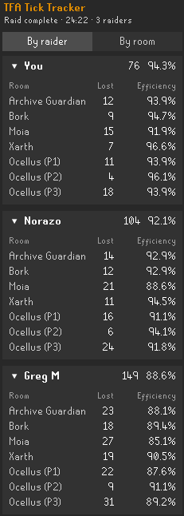

# Tfa Tick Tracker

Measures the attack ticks you lost, room by room, in The Fractured Archives.

A tick you were off cooldown, in a live fight, with something to hit, and did not attack is a tick lost.

## The overlay

The fight you are in at the top, then every room of the raid with its lost ticks and efficiency. The
party table is off by default.

## The panel

The finished raid, one card per raider, with a toggle to pivot the same numbers by room.

## What is charged

Every attack commits you for its weapon's speed, and being past that with a target up and nothing
fired is lost. Eating is charged separately so you can see what the food cost. A boss leaping out of
reach or a phase handing over takes the chance away rather than wasting it, so neither is charged.

## Other raiders

Only your own attacks can be measured: attack speed, weapon and attack option are not readable for
other players. Everyone else self-reports over the RuneLite party, so they appear only if they run
this plugin too. Room totals are all that ever leave your client.
